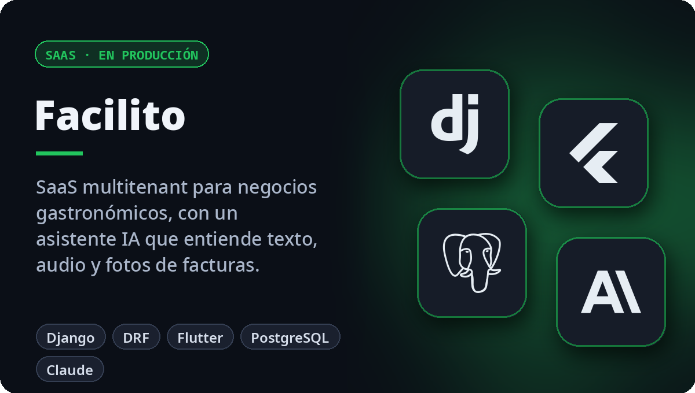
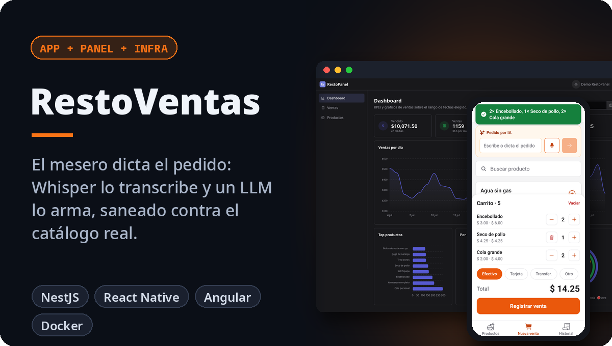
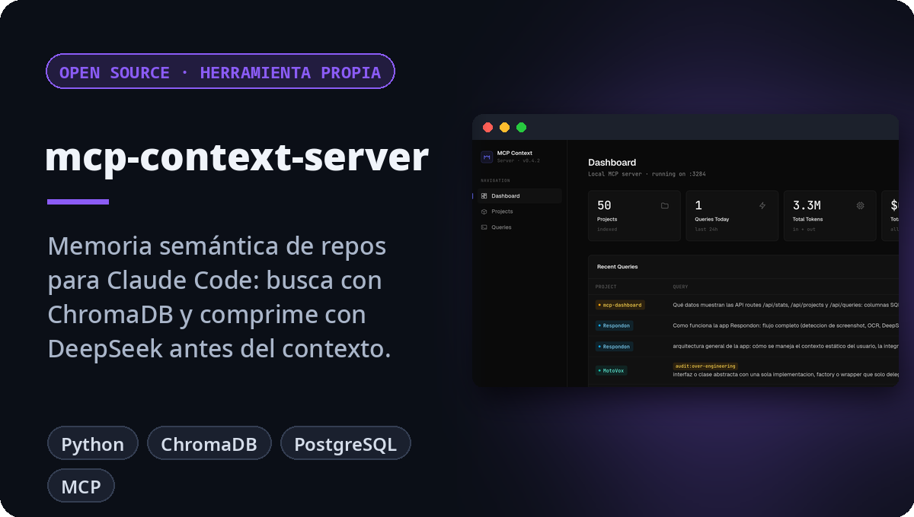
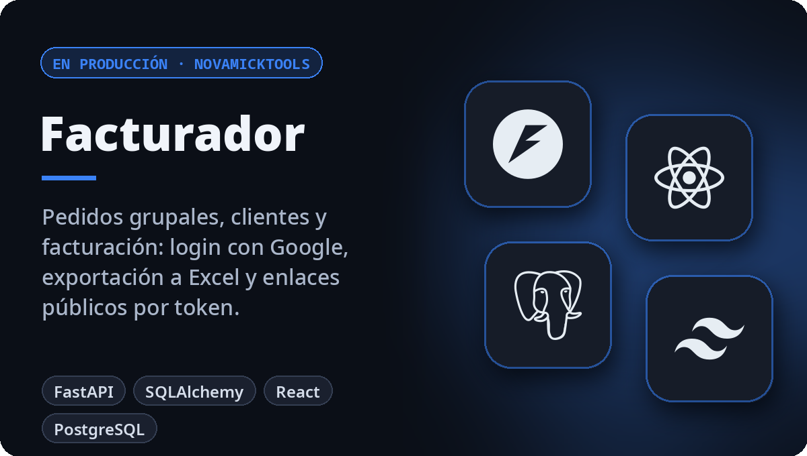
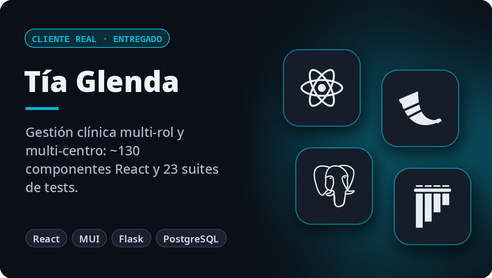
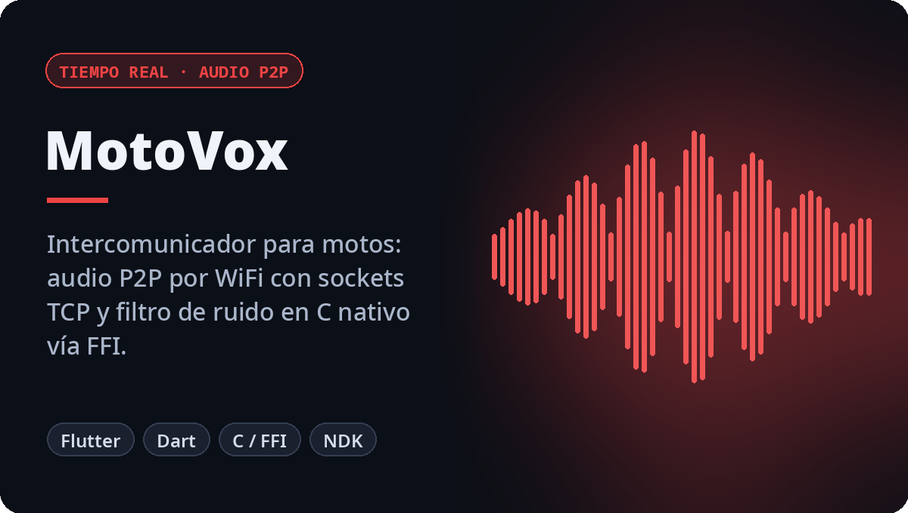
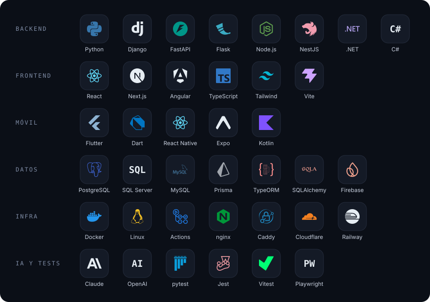

### Construyo sistemas web y móviles completos, de la base de datos a la interfaz.

[**Proyectos**](#proyectos) • [**Stack**](#stack) • [**Experiencia**](#experiencia) • [**Formación**](#formación) • [**Contacto**](#contacto)

---

Estudiante de último semestre de Ingeniería de Software en la Universidad de Guayaquil (9.01/10).

- **Ahora:** pasante de desarrollo en el ERP corporativo de Grupo Lucky, con .NET, Angular y SQL Server.
- **Construyendo:** [Facilito](https://github.com/Mickaell22/facilito-backend), un SaaS para restaurantes, como co-fundador.
- **Me importa:** IA que no se cree a ciegas lo que devuelve el modelo, y verificar cada fix contra datos reales.

## Proyectos

<table>
<tr>
<td width="50%" valign="top">

<a href="https://github.com/Mickaell22/facilito-backend">backend</a> · <a href="https://github.com/Mickaell22/facilito-frontend">app Flutter</a>

</td>
<td width="50%" valign="top">

<a href="https://github.com/Mickaell22/restoventas-app">app</a> · <a href="https://github.com/Mickaell22/restoventas-backend">backend</a> · <a href="https://github.com/Mickaell22/restopanel">panel</a> · <a href="https://github.com/Mickaell22/RestoOps">infra</a>

</td>
</tr>
<tr>
<td width="50%" valign="top">

<a href="https://github.com/Mickaell22/mcp-context-server">servidor</a> · <a href="https://github.com/Mickaell22/mcp-context-dashboard">dashboard</a> · 

</td>
<td width="50%" valign="top">

<a href="https://novamicktools.com">en vivo</a> · <a href="https://github.com/Mickaell22/Facturador_Backend">backend</a> · <a href="https://github.com/Mickaell22/Facturador_Frontend">frontend</a>

</td>
</tr>
<tr>
<td width="50%" valign="top">

<a href="https://github.com/Mickaell22/ProjectTiaGlendaFrontend">frontend</a> · <a href="https://github.com/Mickaell22/ProjectTiaGlendaBackend">backend</a>

</td>
<td width="50%" valign="top">

<a href="https://github.com/Mickaell22/MotoVox">repositorio</a>

</td>
</tr>
</table>

<b>Más proyectos</b>

 

| Proyecto | Qué hace | Stack |
|---|---|---|
| [SimuladorPreguntas](https://github.com/Mickaell22/SimuladorPreguntasBackend) | Simulador de exámenes de ingreso desplegado en la Universidad de Guayaquil, con medidas anti-trampa | Express, React, PostgreSQL, Docker |
| [ApplyJob](https://github.com/Mickaell22/ApplyJob) | Agrega ofertas de 13 fuentes (APIs, RSS, HTML y SPAs con Playwright) y las puntúa contra un perfil | Python, Playwright, LLMs |
| [QR Shield](https://github.com/Mickaell22/qr-shield) | Detector de QR maliciosos contra el quishing (tesis), con heurísticas de URL y tests | FastAPI, pytest |
| [chat-server](https://github.com/Mickaell22/chat-server) | Chat con llamadas de voz WebRTC en malla P2P y CI/CD con healthcheck post-deploy | Express, Socket.IO, Prisma |
| [Respondón](https://github.com/Mickaell22/Respondon) | Detecta tus capturas, extrae el texto con OCR local y responde en una burbuja flotante | Kotlin, Compose, ML Kit |
| [Ceragen 3](https://github.com/Mickaell22/ceragen-3) | Gestión para un centro de fisioterapia, en construcción | FastAPI, PostgreSQL, React |
| [Portafolio](https://github.com/Mickaell22/mickaell-portafolio) | Portafolio y CV dinámico bilingüe, con case studies en MDX | Next.js, shadcn/ui |

## Stack

## Experiencia

| Periodo | Rol | Dónde |
|---|---|---|
| ago 2026 – hoy | Pasante de Desarrollo de Software | Grupo Lucky, ERP corporativo |
| feb 2026 – hoy | Co-fundador y Desarrollador Fullstack | Facilito |
| jul 2025 – hoy | Desarrollador Fullstack freelance | Clientes en Guayaquil |
| feb 2026 – jul 2026 | Pasante de Desarrollo de Software | Área de Nivelación, Universidad de Guayaquil |

<b>Qué hago en Grupo Lucky</b>

 

ERP multi-repo: 5 backends .NET en capas con Dapper sobre stored procedures de SQL Server y un frontend Angular, en los módulos de RRHH, comercial y finanzas de la operación de Ecuador.

- Calculador de décimos (tercero y cuarto, Costa y Sierra) construido de cero: stored procedures, API .NET en 4 capas y pantalla Angular, con cálculo persistido por corrida, el CSV oficial del Ministerio del Trabajo generado por el sistema y cierre de período.
- Un reporte de asistencia que no terminaba de cargar pasó a búsquedas O(1) por diccionario.
- Bitácora de compras llevada de demo a producción (PHP + MySQL): extracción de órdenes y facturas con pdf.js en el navegador y gráficos SVG propios.
- Unas 20 incidencias de producción resueltas, cada fix validado contra la base real.

<b>Freelance y Facilito</b>

 

- **Facilito:** multitenancy forzada por queryset (un manager `for_tenant()` sobre un modelo base abstracto), Django 5 + DRF + PostgreSQL, app Flutter + Riverpod y asistente IA con DeepSeek, Whisper y Claude.
- **Freelance:** gestión clínica para el Centro Tía Glenda, integración con el SRI de Ecuador para un e-commerce (XML, clave de acceso de 49 dígitos y sobres SOAP, en ambiente de pruebas), simulador de exámenes universitario y sistema para un taller mecánico.

## Formación

**Ingeniería de Software**, Universidad de Guayaquil · 2021 – hoy · último semestre, promedio 9.01/10

En seguridad aprendo con laboratorios: pentesting sobre Windows 7 en un entorno controlado (EternalBlue, SMB Relay, NTLM, pivoting), documentado en [YouTube](https://www.youtube.com/@mickaell1335). De ahí salió [QR Shield](https://github.com/Mickaell22/qr-shield).

## Contacto

**Abierto a roles fullstack y proyectos freelance.** Guayaquil, Ecuador.

